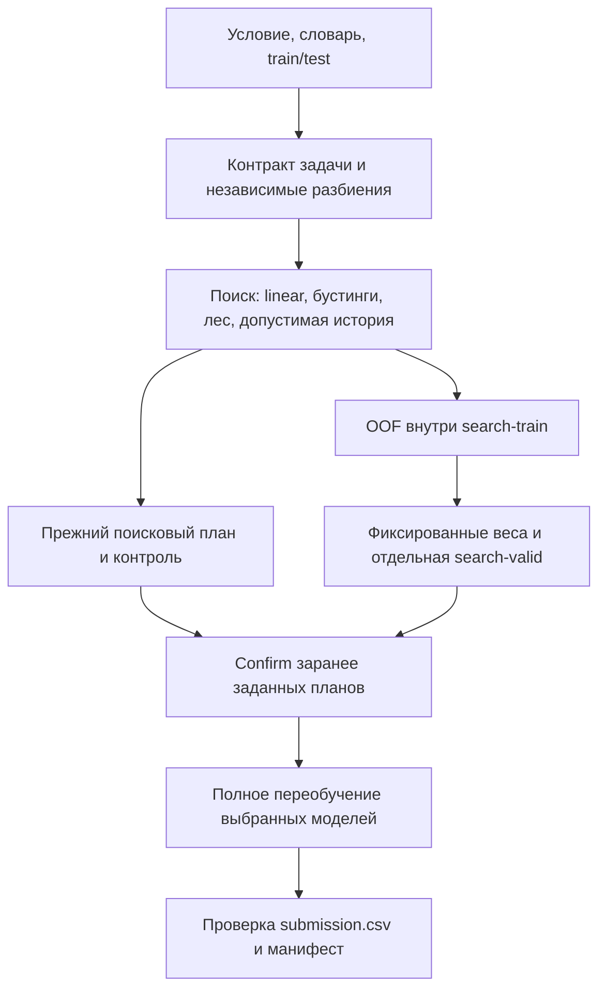

# Alfa AutoResearch

Автономный агент для табличного ML: читает условие и словарь, выбирает метрику
и валидацию, сравнивает Ridge/LogisticRegression/CatBoost/LightGBM/ExtraTrees, проверяет гипотезы через Qwen и
сохраняет `submission.csv`. Для текстовых столбцов предусмотрен TF-IDF с
линейной моделью, без предобученных весов.

Для временной регрессии с описанным ключом сущности агент может использовать
историю её прошлых значений. Для объектов без истории проверен резерв из
ExtraTrees и LightGBM с Huber loss. Применимость определяется по метаданным и
обучающей части; названия публичных задач в правилах не используются.

## Выпуск v4, 27 октября 2026 года

Для платформы: [alfa_solution_v4_2026-10-27.zip](dist/alfa_solution_v4_2026-10-27.zip),
79 080 байт, 23 Python-модуля и исходный `requirements.txt`.
[SHA-256](dist/alfa_solution_v4_2026-10-27.zip.sha256):
`ce4d46965cc4f13eae67e0eeb0033c284bf6e9e3cbe48c9782964a3d2ea15708`.
Архив побайтно совпадает с испытанным v4-кандидатом.
[Как выбрать ZIP, проверить хэш и прочитать результат отправки](docs/SUBMISSION.md).

Ridge и логистическая регрессия теперь проверяются первыми на всех задачах.
Реализован OOF-поиск смеси бустинга, леса и линейной модели с независимыми
проверками замороженных весов. Результаты полного сравнения с v3:

| Проверка | v3 | v4 |
|---|---:|---:|
| Публичная регрессия, confirm RMSE ↓ | 38,862101 | 38,862101 |
| Публичная классификация, confirm Macro F1 ↑ | 0,611110 | 0,611110 |
| Синтетическая линейная регрессия, отдельный тест RMSE ↓ | 21,045203 | 0,259924 |
| Синтетическая классификация, отдельный тест Macro F1 ↑ | 0,848755 | 0,942262 |

Ранний linear доказал пользу на синтетике и сохранил публичное качество.
OOF не дал дополнительного прироста в этих четырёх задачах: его смеси
отклонены отдельной проверкой либо совпали с уже выбранной линейной моделью.
Он остаётся ограниченным поисковым этапом для новых задач; без улучшения
на отдельных проверках прежний план сохраняется. `--no-oof` отключает этап.

Linux: 202/202 теста. Выполнены четыре новых полных публичных прогона и шесть
синтетических A/B/C-прогонов, всего 166 новых ML-обучений без ошибок;
все завершили полный refit и CSV. Независимо пересчитаны метрики, OOF-веса
и финальные ответы, проверены 59 фиксированных обучений / 67 компонентов
сохранённых моделей. [Таблица и выводы](docs/LINEAR_OOF_RESEARCH.md),
[результаты](docs/LINEAR_OOF_RESULTS.json),
[аудит моделей](docs/LINEAR_OOF_MODEL_AUDIT.json).
Платформенный балл v4 пока неизвестен; синтетика его не предсказывает.

Сохранены исправления v3: специальные имена признаков LightGBM,
обработка настроек/ошибок LLM, положительного класса `0.0`, безопасные
журналы и проверка готового CSV. [Аудит судей](docs/JUDGES_AUDIT.md),
[предыдущий контроль v3](dist/alfa_solution_v3_audit_candidate.zip).

## Запуск

Python 3.12; версии платформы сохранены в `requirements.txt` без изменений.
Для облегчённого локального стенда:

```bash
python -m pip install -r requirements-dev.txt
export OPENAI_API_KEY='ключ команды'
export OPENAI_BASE_URL='https://api.alfahack-gateway26.ru/v1'
export OPENAI_MODEL='qwen/qwen3.8-27b'
python solution.py /path/to/task.md
```

В Windows можно подготовить изолированный Python внутри `.tools`, не меняя
системную установку:

```powershell
python tools/bootstrap_windows.py
$env:OPENAI_API_KEY = 'ключ команды'
$env:OPENAI_BASE_URL = 'https://api.alfahack-gateway26.ru/v1'
$env:OPENAI_MODEL = 'qwen/qwen3.8-27b'
.\.tools\python312\python.exe solution.py .\runs\public\regression\task.md
```

Ключ не включается в исходники и ZIP. `.env` не загружается автоматически.
В проверяющем контейнере используются переменные окружения организаторов.
Без API работает локальный исследовательский портфель с тем же ML-движком.
Обычный планировщик выбран по умолчанию. Явный `--planner sgr` включает
планировщик с JSON Schema: краткие наблюдения, гипотеза, риск, способ проверки
и конфигурация модели. Сервер должен поддерживать `response_format=json_schema`.
Протокол отдельной проверки пользы SGR: [SGR_PROTOCOL.md](docs/SGR_PROTOCOL.md).

## Короткий локальный прогон

Сначала создайте копию материалов, чтобы не изменять оригинал:

```bash
python tools/prepare_public.py /path/to/data_for_participants
python solution.py runs/public/regression/task.md --time-limit 600 --max-experiments 6 --max-iterations 1200 --no-llm
python solution.py runs/public/classification/task.md --time-limit 900 --max-experiments 8 --llm-calls 2
```

Ограничения короткого прогона не меняют штатный режим. По умолчанию агент
имеет до 10800 секунд, до 18 поисковых экспериментов и до 6 запросов к LLM.
Завершается раньше при исчерпании портфеля улучшений или отсутствии прогресса.
Число потоков модели по умолчанию 7, максимум 8 с учётом доступных CPU.

## Как устроено решение



1. Условие, словарь, train/test и шаблон совместно определяют контракт задачи.
2. Подтверждённые идентификаторы исключаются из признаков и сохраняются строками.
3. После чтения данных записывается проверенный резервный ответ.
4. При будущих периодах теста используется временная валидация. При повторах —
   непересекающиеся группы с учётом классов.
5. Подтверждающая выборка отделена от поиска: её строки не участвуют даже
   в обучении поисковых моделей. Для времени используются последовательные периоды.
6. Qwen предлагает конфигурации и ограниченные операции над признаками.
   Свободное выполнение сгенерированного моделью кода не используется.
7. Из проверенной конфигурации генерируется исполняемый Python-эксперимент.
   Отдельный процесс ограничивается по времени и памяти, API-ключ ему не передаётся.
8. Весь план — состав моделей, веса и число деревьев — выбирается на поиске и
   фиксируется до подтверждения. Подтверждение допускает возврат только к заранее
   выбранному контролю; ранней остановки на этой выборке нет.
9. Финальное обучение на всех данных запускается только при наличии резерва.
   Неудачный refit сохраняет предыдущий проверенный CSV.

### Ранние линейные модели и ансамбль OOF

Первый эксперимент всегда проверяет линейное семейство: Ridge для регрессии
или логистическую регрессию для классификации. Числовые пропуски заполняются
по обучающей части, признаки масштабируются; категориальные признаки кодируются,
текст преобразуется в TF-IDF. Нули сами по себе не считаются пропусками.
Регуляризация линейной модели исследуется отдельно от параметров деревьев.

После поиска OOF-контроллер выбирает по одному представителю трёх семейств:
бустинг, ExtraTrees и линейная модель. Внутри поисковой обучающей части создаются
до трёх независимых фолдов. Профиль и преобразования каждого фолда обучаются
только на его тренировочных строках; число итераций фиксировано, ранняя остановка
по OOF-ответам отключена. Дубликаты разделяются группами, временные задачи —
строго по хронологии. Редкие классы или недостаточный бюджет приводят к пропуску
этого этапа с явной причиной в журнале.

Неотрицательные веса с суммой 1 подбираются по OOF-прогнозам на закрытой сетке.
Нулевой вес допустим: добавлять бесполезную третью модель принудительно агент
не обязан. Замороженная смесь проходит поисковую проверку и отдельное подтверждение
против заранее зафиксированного прежнего плана и контроля. Только после этого
выбранные компоненты переобучаются на полном train. Для воспроизводимого сравнения
`--no-oof` отключает этот этап, сохраняя раннюю линейную модель.

OOF занимает не более выделенного бюджета этапа (до 12% общего времени),
не переносит прогнозы между задачами и сохраняет матрицу прогнозов, индексы,
конфигурации, веса и счётчики обучений в `.alfa_runs/<id>/oof/`.

Воспроизведение сравнения на подготовленных публичных файлах:

```bash
python tools/package_solution.py --output dist/alfa_solution_v4_candidate.zip
python tools/run_release.py runs/public/regression/task.md --zip dist/alfa_solution_v4_candidate.zip --cpus 4 --memory-gb 14 --no-oof
python tools/run_release.py runs/public/regression/task.md --zip dist/alfa_solution_v4_candidate.zip --cpus 4 --memory-gb 14
python tools/run_linear_oof_benchmarks.py classification
python tools/make_linear_benchmarks.py
python tools/run_linear_oof_benchmarks.py synthetic
python tools/report_linear_oof.py
```

Сводный reporter также использует сохранённые v3-контроли и пути текущего
исследования. Для отдельных новых запусков используйте
`python tools/report_release.py <каталог-прогона> --output <отчёт.json>`.
Генератор синтетики сохраняет истинные тестовые ответы отдельно: в контейнер
попадают только условие, train/test, словарь, шаблон и код соответствующего ZIP.

В `.alfa_runs/<идентификатор>/` рядом с задачей сохраняются профиль, индексы
разбиений, JSONL-журнал, конфигурации, сгенерированные программы, метрики,
модели, предсказания и `summary.json`. Артефакты задач не переносятся друг в друга.
Профиль строится только на поисковой обучающей части. Итоговый CSV дополнительно
проверяется по схеме, идентификаторам, порядку классов и допустимости значений;
рядом записывается `submission.manifest.json` с контрольными суммами.

Основные поддерживаемые метрики: RMSE, MAE, MSE, RMSLE, MAPE, R², Macro/Weighted F1,
бинарная F1, Accuracy, Balanced Accuracy, ROC AUC, Average Precision, Log Loss.
Для вероятностей классов поддерживаются шаблоны с отдельной колонкой каждого
класса; для бинарной задачи — одна колонка вероятности положительного класса.
Явное указание положительного класса в условии имеет приоритет; иначе им
считается последний класс в лексикографическом порядке.
Многотаргетные задачи, изображения и ранжирование не заявлены как поддерживаемые.

## Проверки и ZIP

```bash
python tests/run_tests.py
python tools/package_solution.py
```

Результат сборки: `dist/alfa_solution.zip` и SHA-256 рядом. Состав задаётся
явным списком: только 22 корневых `.py` и оригинальный `requirements.txt`.
Вложенные пакеты, данные, конфиги, ключи и модели не включаются. Сборка
воспроизводима. Интеграционные тесты запускают именно распакованный архив.

Результаты проведённых прогонов: [локальные метрики](docs/VALIDATION.md),
[автоматические проверки](docs/TESTS.md), [архитектура](docs/ARCHITECTURE.md).
Последняя интеграция предложений GPT2/Q2: [сравнение методов](docs/INTEGRATION_RESEARCH.md).
Полные сравнения старого и нового ZIP: RMSE **46,5833 → 38,8621**;
Macro F1 **0,60420 → 0,61111**. Это локальные публичные проверки, не оценка
скрытых задач платформы; [независимо проверенные артефакты](docs/RELEASE_RESULTS.json).

## Проверка Linux

```bash
docker build -t alfa-agent .
docker run --rm --cpus=8 --memory=29g --memory-swap=29g --network=none -v /absolute/task:/task alfa-agent task.md --no-llm
python tools/check_linux.py runs/public/classification/task.md --time-limit 900 --max-experiments 8
```

Этот Dockerfile предназначен для локального стенда на основном стеке;
платформа устанавливает полный организаторский список самостоятельно.
Для штатного LLM-режима требуется разрешённый доступ к шлюзу и переменные API.
Локальные валидационные метрики не являются баллами скрытого теста платформы.

Для Macro F1 портфель после раннего linear проверяет умеренные веса классов в обоих
семействах бустинга. Полная балансировка и более глубокие модели сравниваются
отдельно: они не считаются улучшениями без валидации. CatBoost использует
Macro F1 для ранней остановки, LightGBM — свою гладкую функцию потерь;
ранжирование всех экспериментов выполняется по основной метрике задачи.

## Исследование альтернатив

Предварительный анализ и протокол: [три иных принципа обучения](docs/UNCONVENTIONAL_RESEARCH.md).
Сохранённые метрики и условные интервалы: [результаты](docs/UNCONVENTIONAL_RESULTS.json).
Сравниваются ExtraTrees, приближённое ядро Nyström и метрическая память соседей.
Семейства и вес комбинации с существующим контролем выбираются на поисковой части;
параметры сохраняются до отдельной подтверждающей проверки.

```bash
docker build -t alfa-agent:local .
docker build -f Dockerfile.research -t alfa-research:local .
python tools/run_unconventional.py runs/public/classification/task.md
python tools/run_unconventional.py runs/public/regression/task.md
```

Каждая команда создаёт собственный каталог в `runs/unconventional`, упаковывает
`dist/alfa_unconventional.zip` и проверяет его в Linux без сети и ключа API.
Лимиты целого запуска: 8 CPU, 29 ГиБ RAM, без дополнительного swap, до 10800 секунд.
Версии установленных зависимостей и исходный `requirements.txt` проверяются до обучения.
Образы Docker собираются заранее; внутри решения установки пакетов нет.

Отчёт по сохранённым предсказаниям двух завершённых каталогов:

```bash
python tools/report_unconventional.py runs/unconventional/<классификация> runs/unconventional/<регрессия>
```

Машинные результаты сохраняются в `docs/UNCONVENTIONAL_RESULTS.json`. Исследовательский
архив воспроизводит сравнение; штатная точка входа агента — `solution.py`, штатная сборка —
`tools/package_solution.py`.

В штатный агент включён один ограниченный по размеру ExtraTrees-кандидат. Он
проверяется на обеих задачах без условий по названиям таргетов или столбцов.
Ядерная модель и память соседей доступны в отдельном исследовательском прогоне.

## Новые проверки Kaggle и AIDE

[Подробный русский отчёт](docs/KAGGLE_RESEARCH.md),
[протокол](docs/KAGGLE_PROTOCOL.md),
[независимо пересчитанные результаты](docs/KAGGLE_RESULTS.json).
Проверены история повторных сущностей, модельное восстановление пропусков,
погодный PCA, direct XGBoost и ограниченный поиск по дереву конфигураций.
В основном сравнении этого этапа новые ветви не превзошли тогдашний сильный контроль:
46,583300 RMSE и 0,611110 Macro F1. На том этапе штатный портфель сохранили;
позднейшая интеграция исторического маршрутизатора описана выше.

Усреднение истории по четырём seed дало перспективный результат на уже
просмотренном периоде: 43,992874 против 46,774341 у усреднённого контроля.
Это дополнительная проверка устойчивости после просмотра подтверждения,
а не независимое доказательство прироста; в дефолт она не включена.

```bash
python tools/run_kaggle.py runs/public/regression/task.md --no-llm
python tools/run_kaggle.py runs/public/classification/task.md --no-llm
python tools/report_kaggle.py runs/kaggle/<регрессия> runs/kaggle/<классификация>
python tools/run_kaggle_repeats.py runs/kaggle/<регрессия> --seeds 43 44 45
python tools/report_kaggle_repeats.py runs/kaggle/<регрессия>
```

Для общего Qwen-пула вместо `--no-llm` используется `--key-file /path/APIkey.txt`;
контейнер получает только разрешённый шлюз через CONNECT-прокси. Один запрос
на задачу, обе политики имеют одинаковый доступ к результату. Реальные
исследовательские архивы и модели сохраняются в `runs`, в штатный ZIP не входят.

## Проверка предложений GPT и Qwen

По двум присланным ответам отобраны 13 новых рецептов: шесть GPT и семь Qwen.
[Протокол](docs/AI_PROPOSALS_PROTOCOL.md),
[таблицы и выводы](docs/AI_PROPOSALS_RESEARCH.md),
[независимый пересчёт](docs/AI_PROPOSALS_RESULTS.json).
Медианы, история, веса конфликтов и калибровки обучаются внутри train-частей;
поисковые веса смеси и итерации фиксируются до подтверждения.

```bash
python tools/run_ai_proposals.py runs/public/regression/task.md
python tools/run_ai_proposals.py runs/public/classification/task.md
python tools/report_ai_proposals.py runs/ai_proposals/<регрессия> runs/ai_proposals/<классификация>
```

Это отдельный офлайн-стенд в `runs/ai_proposals`, до 8 CPU / 29 ГиБ / 10800 с
на задачу. LLM и сеть не используются. ZIP и исходники каждого запуска
сохраняются вместе с прогнозами, OOF, замороженными параметрами и итоговым CSV.
Штатный выпускной архив сохраняется отдельно.

## Итог проверки SGR

Реальный парный тест:8запросов,24обучения,21626токенов. SGR выиграл две пары
и проиграл две; прироста к сильному контрольному решению нет. Обычный
планировщик сохранён по умолчанию, SGR доступен через `--planner sgr`.
[Таблицы и решение](docs/SGR_RESEARCH.md), [проверенные артефакты](docs/SGR_RESULTS.json).
Исторический архив этапа SGR:
[alfa_solution_v2_2026-10-26.zip](dist/alfa_solution_v2_2026-10-26.zip).
Его содержимое и SHA-256 после теста не менялись.

Проверка LLM-клиента v3: [мини-отчёт](docs/LLM_CLIENT_FINAL_CHECK.md),
16 целевых ZIP-тестов и 33 SDK-сценария на Windows/Linux прошли.
Из нового v4-кандидата повторно пройдены все 33 SDK-сценария Windows,
без сети и ключей. Сам LLM-клиент в этом выпуске не менялся.

## Тестирование

```bash
python -m unittest discover -s tests -v
```

Для встроенного Windows Python нужен явный путь проекта:

```powershell
.\.tools\python312\python.exe -c "import sys,unittest;sys.path[:0]=['.','tests'];r=unittest.TextTestRunner(verbosity=2).run(unittest.defaultTestLoader.discover('tests'));sys.exit(not r.wasSuccessful())"
```

Новая проверка Linux: 202/202 passed. Windows: полный набор 201 тест
(198 passed + 3 skip), затем отдельно пройден последний добавленный тест
неизменности прогнозов при изменении valid-target — итого 199 passed + 3 skip.
Подробности: [TESTS.md](docs/TESTS.md).
